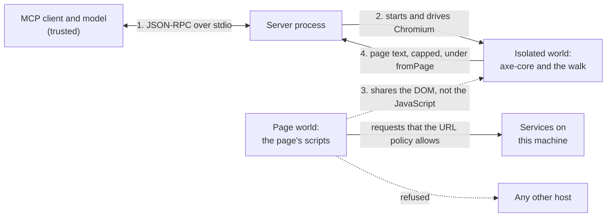

# Threat model

What the MCP server `wcag-evidence-mcp` and the repository's supply chain defend against, how, and what is left. The threats of the benchmark come with the benchmark. To report a vulnerability, see [SECURITY.md](SECURITY.md).

**In short.** The server opens only pages served on this machine, keeps Chromium off the network beyond it and in its sandbox, lets a page write only to its own port, with the gaps listed below, runs its own code where the page's scripts cannot reach it, and lets text of the page reach the agent only labeled, capped and cleaned. Each mitigation below cites the tests that show it, and the gate checks that those tests exist. What stays open:

- **Reads of local services:** a hostile page or URL still reaches every `http` service on this machine with a read (a GET, HEAD or OPTIONS), and a few paths that Playwright's interception does not see carry writes too ([below](#requests-to-the-other-services-on-this-machine)).
- **Chromium without its sandbox,** where the system does not allow it, as on Ubuntu 23.10 and later without unprivileged user namespaces, in some containers or as root: whoever starts the server can turn the sandbox off, and a page that exploits a flaw of the browser then runs code with the rights of whoever started the server ([below](#chromiums-sandbox)).

## What is protected

- **The developer's machine and its files.** The server runs with the developer's rights and drives a browser that runs the code of the page under audit.
- **The services on loopback,** the addresses that never leave this machine, `localhost` and `127.0.0.1`: development servers, databases and tools that listen there and trust what reaches them.
- **The agent's context.** Text of the page reaches the model through the output of `audit_route`, and the model may act on it.
- **The integrity of a verdict.** A page must not be able to make the audit report a pass where it fails, or a failure where it passes.
- **The build and its dependencies.** What `npm ci` installs, what CI runs and the Chromium that the server drives.

## Who can attack, and from where

| Who                                                                                                                           | Reaches                                                                                             | In scope                                                                        |
| ----------------------------------------------------------------------------------------------------------------------------- | --------------------------------------------------------------------------------------------------- | ------------------------------------------------------------------------------- |
| A hostile page, or a local app, that the agent is asked to audit                                                              | Its scripts run in Chromium; its text reaches the output; it can try to change what the audit reads | Yes                                                                             |
| A hostile URL in the agent's input, as from an issue or a prompt injection (instructions hidden in text that the agent reads) | The URL that `audit_route` is asked to open                                                         | Yes                                                                             |
| A compromised dependency: an npm package, a GitHub Action or the Chromium build                                               | The developer's machine at install and at run time, and CI                                          | Yes, for what the repository can check                                          |
| The MCP client, the model and the developer                                                                                   | Everything the server does: they start it and choose each call                                      | No: they are trusted. The server cannot defend against the program that runs it |

## Trust boundaries

1. **Client and server, over stdio.** The client is trusted. The server checks each input against its schema, writes only protocol messages to stdout and its log to stderr.
2. **Server and Chromium.** The server starts Chromium in its sandbox, with no network beyond this machine, talks to it over a pipe and opens each page in a context of its own.
3. **The page and the isolated world.** The audit's code runs in an isolated world, a separate JavaScript context that Chromium gives to tools and extensions inside a page: it shares the page's DOM, but the page's scripts cannot change the JavaScript that it uses.
4. **Page text and the output.** Text that the page wrote reaches the output only under `fromPage` keys, capped and cleaned, and the tool says that it is data.

## Threats

### A URL that leaves the machine

**Threat.** The agent is asked to open a remote URL, or a local page makes Chromium send requests, open sockets or reach a redirect target elsewhere: the audit would send data out, or audit someone else's site.

**Mitigation** ([ADR 0005](docs/adr/0005-url-policy.md)), in layers:

- `checkUrl` accepts only `http` to `localhost` or `127.0.0.1`, written exactly so, with an explicit port other than 80, before any page opens;
- every request of the page, its frames and its dedicated workers, and every WebSocket of the page and its frames, goes through the same check and is cut when it fails; a popup opens in the same context, under the same checks;
- Chromium's resolver maps every host but `localhost` and `127.0.0.1` to nothing, with no proxy and no UDP for WebRTC: this rule is what stops traffic to other addresses, including what the interception cannot see;
- the document must come from `127.0.0.1` or `::1`: this check refuses the result after the request has left, when a name resolved elsewhere;
- service workers and downloads are refused.

DNS rebinding, a name that resolves first to this machine and then elsewhere, does not apply: Chromium resolves `localhost` itself, and `checkUrl` accepts no other name.

**Tests:**

- `packages/wcag-evidence-mcp/test/url-policy.test.ts > $case: $text`, the table of spellings that reach this machine or not
- `packages/wcag-evidence-mcp/test/url-policy.test.ts > gives the same answer for an allowed URL and for the URL that it returns`
- `packages/wcag-evidence-mcp/test/playwright-policy.test.ts > refuses a URL that fails checkUrl, and nothing reaches the site`
- `packages/wcag-evidence-mcp/test/playwright-policy.test.ts > are cut when checkUrl refuses them, even when the host resolves`
- `packages/wcag-evidence-mcp/test/playwright-policy.test.ts > are checked in frames and workers that have no network address of their own`
- `packages/wcag-evidence-mcp/test/playwright-policy.test.ts > are checked in a popup too, which opens in the same context`
- `packages/wcag-evidence-mcp/test/playwright-policy.test.ts > to another host is stopped by the resolver, which Playwright cannot see`
- `packages/wcag-evidence-mcp/test/playwright-policy.test.ts > of a subresource to another host is stopped too, and reported`
- `packages/wcag-evidence-mcp/test/playwright-policy.test.ts > is closed before it leaves the browser when checkUrl refuses it`, for a WebSocket
- `packages/wcag-evidence-mcp/test/playwright-policy.test.ts > sends no UDP packet, which neither the interception nor the resolver rule would see`
- `packages/wcag-evidence-mcp/test/playwright-policy.test.ts > must be the local machine, even when a name resolves to another address`
- `packages/wcag-evidence-mcp/test/playwright-lifecycle.test.ts > starts on the first visit only, with the resolver rule and no proxy, and closes`
- `packages/wcag-evidence-mcp/test/playwright-lifecycle.test.ts > blocks service workers and refuses downloads in every context, and fails without an address`, which shows the options that the adapter passes, on a stand-in for Chromium, not a download refused by a real one
- `packages/wcag-evidence-mcp/test/server.test.ts > refuses a URL that fails the URL policy, with an error and no findings`

**What remains, not mitigated** ([limits against ADR 0005](docs/architecture.md#limits-against-adr-0005)):

- A redirect hop that stays on this machine but fails `checkUrl` reaches its service. The visit fails if the hop belongs to the document; for a subresource, the page uses the answer and the visit only lists the hop.
- The WebSockets of a dedicated worker, and the requests and WebSockets of a shared worker or of speculation rules, are not checked. The resolver keeps them on `localhost` and `127.0.0.1`, but on any port.

### Requests to the other services on this machine

**Threat.** The page's scripts send requests to another service on loopback, such as a development API with no authentication, while the agent audits the page; a form-style POST is the usual way to make such a service act. A hostile URL in the agent's input can also point the server at any of them, with one GET ([ADR 0005](docs/adr/0005-url-policy.md)).

**Mitigation** ([ADR 0009](docs/adr/0009-local-port-writes.md)): a request other than GET, HEAD or OPTIONS, and a WebSocket, go only to the page's own port, that of the first document that its main frame commits, which never moves. The rule covers `fetch`, forms, `sendBeacon`, `fetch` with `keepalive`, frames, popups and dedicated workers, and each refusal counts in `refusedRequests`. Each visit gets a fresh context, with no cookies or storage of another visit, so a request carries no session of the developer. The policy allows only `http`.

**Tests:**

- `packages/wcag-evidence-mcp/test/playwright-ports.test.ts > reads from another local port, but every way it has to write there is cut`, where the other server receives no write
- `packages/wcag-evidence-mcp/test/playwright-ports.test.ts > opens a WebSocket to its own port only`
- `packages/wcag-evidence-mcp/test/playwright-ports.test.ts > keeps its own port when it goes to a document on another port, which cannot write there`
- `packages/wcag-evidence-mcp/test/port-rule.test.ts > on %s, %j to %s gives %j`
- `packages/wcag-evidence-mcp/test/port-rule.test.ts > lets a page with no document of its own yet only read`
- `packages/wcag-evidence-mcp/test/playwright-policy.test.ts > gives each visit a context of its own, with no cookie or storage from another`
- `packages/wcag-evidence-mcp/test/playwright-ports.test.ts > can still write to another port through a redirect of its own server, which is only seen`, which shows a gap below

**What remains:**

- **Reads** (GET, HEAD and OPTIONS) reach every port of `localhost` and `127.0.0.1`. A service that trusts loopback without a credential and acts on a read is exposed, to the page and to the agent's URL.
- **CORS preflights:** while it intercepts, Playwright answers the browser's preflights itself (a 204 with the request's origin, methods and headers, and credentials allowed), and they never reach the service. So a request that a service on another port would have refused at its preflight is sent anyway: the port rule stops it for a write, not for a read with custom headers, such as a GET with `X-Csrf`. This dates from the route interception of ADR 0005, not from ADR 0009.
- **A redirect that keeps its method:** a 307 or 308 from the page's own server carries a write to another port. The visit lists it; it does not stop it.
- **The paths that the interception does not see:** the WebSockets of dedicated workers, the requests and WebSockets of shared workers, and speculation rules ([limits against ADR 0005](docs/architecture.md#limits-against-adr-0005)).
- **Writes to the page's own port,** from its own scripts, as an app that saves a field when it loads.

### Instructions in the page's text

**Threat.** A prompt injection: the page writes instructions for the agent in its attributes, names, comments or hidden text, in plain text or in characters that do not show, and the model follows them.

**Mitigation** ([ADR 0006](docs/adr/0006-untrusted-page-text.md)): text of the page reaches the output only under `fromPage` keys; each value has a cap (a selector 200 characters, an opening tag 200, each attribute value 20, a name 120); characters that do not show are dropped or written as CSS escapes; no title, child text, comment, hidden text, event handler code or message of axe-core goes out; a failure is told in the server's own words. The tool's description and schema say that this text is data. No image goes out ([ADR 0007](docs/adr/0007-keyboard-checks.md)).

**Tests:**

- `packages/wcag-evidence-mcp/test/untrusted-text.test.ts > holds the page text only under fromPage keys`
- `packages/wcag-evidence-mcp/test/untrusted-text.test.ts > holds no title, text of children, hidden text, comments or event handler code`
- `packages/wcag-evidence-mcp/test/untrusted-text.test.ts > cuts every attribute value to 20 characters, so no sentence planted in one gets through`
- `packages/wcag-evidence-mcp/test/untrusted-text.test.ts > holds no invisible character: a name or a value drops them, a selector escapes them`
- `packages/wcag-evidence-mcp/test/untrusted-text.test.ts > keeps each selector and opening tag within its cap`
- `packages/wcag-evidence-mcp/test/untrusted-text.test.ts > holds no message of axe-core`
- `packages/wcag-evidence-mcp/test/untrusted-text.test.ts > gives its selector under fromPage, with what does not show escaped, within the cap of a selector`, for the layer of 2.4.11
- `packages/wcag-evidence-mcp/test/server.test.ts > tells the agent, in its description and in its schema, that text under fromPage is data`
- `packages/wcag-evidence-mcp/test/server.test.ts > is explained in the server words, without page text: %s`

**What remains.** A short instruction fits within the caps, as in an `id` that a selector uses or an accessible name. The label tells the model that the text is data; it cannot make the model ignore it. No test has measured how often a model follows such text despite the label.

### A page that fakes a verdict

**Threat.** The page changes what the audit reads, to hide its defects or to report defects it does not have.

**Mitigation:**

- axe-core and the keyboard walk run in the isolated world, which the page's scripts cannot reach ([ADR 0004](docs/adr/0004-server-architecture.md)); a result that the server cannot read fails the call, rather than give an empty audit;
- a page that goes to another document after it loaded is not audited (`navigated`, [ADR 0005](docs/adr/0005-url-policy.md));
- the walk reads focus, places and styles in the isolated world, and hides the text cursor with a style sheet that the page does not see in its lists or in its DOM ([ADR 0007](docs/adr/0007-keyboard-checks.md));
- an element that the page focuses again cannot be compared, and 2.4.7 then goes to `notChecked`.

**Tests:**

- `packages/wcag-evidence-mcp/test/audit-reference.test.ts > gives the reference output despite %s`, with a fake `window.axe`, a changed `Array.prototype.map` and a fake `MutationObserver`
- `packages/wcag-evidence-mcp/test/audit-reference.test.ts > audits the top document when a frame loads its own axe-core`
- `packages/wcag-evidence-mcp/test/audit.test.ts > throws when the engine reports a rule that it was not asked to run`
- `packages/wcag-evidence-mcp/test/server.test.ts > gives an error, not an empty audit, when the rule engine cannot read the page`
- `packages/wcag-evidence-mcp/test/playwright-policy.test.ts > fails with navigated when %s goes %s`
- `packages/wcag-evidence-mcp/test/keyboard-walk.test.ts > gives the same findings on a page that replaces what the walk would read in its own world`
- `packages/wcag-evidence-mcp/test/keyboard-walk.test.ts > is not fooled by a page that turns on a ring when the text cursor is hidden`
- `packages/wcag-evidence-mcp/test/keyboard-walk.test.ts > cannot compare a field that the page focuses again at once, and says so`

**What remains:**

- The page can still read that the computed `caret-color` of its elements is transparent during the walk, and a field whose inline style sets `caret-color` with `!important` keeps its cursor, which then counts as its indicator ([architecture](docs/architecture.md#the-keyboard-walk)).
- Frames are not audited, so a page can put a defect in a frame and get no finding.
- A page can tell that it is being audited, by the headless browser or by the timing of the keys, and show other content. No test: this cannot be prevented, and is accepted below.
- A layer that the page removes about 40 ms after an element gets focus gives a different verdict of 2.4.11 from run to run.

### Denial of service

**Threat.** A page, or a URL, keeps a call running, fills the output, or makes the server use memory without bound.

**Mitigation:** time limits (30 s for Chromium to start and for a page to load, 10 s to settle, 2 minutes for a whole call, the walk included); a cap of 20,000 characters on the output ([ADR 0004](docs/adr/0004-server-architecture.md)); limits on what is read from the page; the walk's cap of twice the tabbable elements plus 6 in each direction; the PNG decoder's refusal of data larger than its image; Chromium started again after a crash.

**Tests:**

- `packages/wcag-evidence-mcp/test/playwright-lifecycle.test.ts > gives up on a page that does not load in time`
- `packages/wcag-evidence-mcp/test/playwright-lifecycle.test.ts > ends when the caller takes longer than the limit of the whole visit`
- `packages/wcag-evidence-mcp/test/playwright-lifecycle.test.ts > ends at the limit when the page never loads`, with a browser that stops answering
- `packages/wcag-evidence-mcp/test/audit-reference.test.ts > audits a page that never stops changing at the end of the wait, and says it did not settle`
- `packages/wcag-evidence-mcp/test/audit.test.ts > keeps the first findings that fit, and counts what it left out by rule`
- `packages/wcag-evidence-mcp/test/audit.test.ts > cuts 50,000 findings in well under the time of a call`
- `packages/wcag-evidence-mcp/test/untrusted-text.test.ts > reads 64 attributes, 100 characters of each name, value and tag, and 1,000 of the name`
- `packages/wcag-evidence-mcp/test/keyboard.test.ts > stops at its cap, twice the elements plus 6, and says the page was not seen whole`
- `packages/wcag-evidence-mcp/test/png.test.ts > refuses data that inflates to more than the image holds`
- `packages/wcag-evidence-mcp/test/playwright-lifecycle.test.ts > starts again on the next visit after it crashed`
- `packages/wcag-evidence-mcp/test/playwright-lifecycle.test.ts > reports a browser that closes during the visit, which is not the caller failing`
- `packages/wcag-evidence-mcp/test/stdio.test.ts > exits with 1 when a fatal transport error stops it while stdin is still open`, for a line longer than the SDK reads

**What remains.** A call can take its full 2 minutes, and the walk's time grows with the page: past about 850 elements that Tab reaches, the keyboard criteria go to `notChecked` ([architecture](docs/architecture.md#the-keyboard-walk)).

### Side effects of an audit

**Threat.** The audit changes the app or its data: it clicks, types, submits a form, downloads a file, or carries state from one page to the next.

**Mitigation:** the tools are read-only and say so in their annotations; the walk presses only Tab, Shift+Tab and, inside a cycle, Escape ([ADR 0007](docs/adr/0007-keyboard-checks.md)); each visit gets a fresh context, closed when the call ends; downloads are refused.

**Tests:**

- `packages/wcag-evidence-mcp/test/server.test.ts > lists audit_route, read-only, with an input and an output schema`
- `packages/wcag-evidence-mcp/test/keyboard-walk.test.ts > presses only Tab, Shift+Tab and Escape: no click, typing or submission reaches the page`
- `packages/wcag-evidence-mcp/test/keyboard.test.ts > tries Escape once in each cycle, so two cycles that it breaks give no trap`
- `packages/wcag-evidence-mcp/test/playwright-policy.test.ts > gives each visit a context of its own, with no cookie or storage from another`

**What remains.** The page's own scripts run, at load and on each key, and can send requests to the app, as an app that saves a field when it loses focus does. Escape runs the page's listeners and can close or reset what is open in a cycle, in the browser of that call.

### Chromium's profile on disk

**Threat.** The cookies, cache and storage of the audited pages stay on disk after the server ends, where another program or user of the machine can read them.

**Mitigation:** Playwright gives each browser that it starts a temporary profile, a folder named `playwright_chromiumdev_profile-*` in the system's temporary folder, and deletes it when the browser closes. The server closes the browser when stdin ends.

**No test** checks that the folder is gone.

**What remains.** A server that is killed leaves the folder behind, with what the audited pages stored: a review found one left after a killed server. Nothing removes it but the system's cleaning of its temporary folder.

### The connection to Chromium

**Threat.** Another program on this machine connects to the browser's DevTools Protocol, the interface through which the server drives Chromium, and reads or drives the pages under audit.

**Mitigation:** the server talks to Chromium over a pipe (`--remote-debugging-pipe`), which only the process that started the browser holds, and no TCP port is opened. `playwright-core` 1.65.1 sets the flag when it launches Chromium, and a real launch of the server's browser had it, with no `--remote-debugging-port` (seen on 2026-11-25).

**No test:** the flag is set by Playwright, not by the server.

### Pollution of stdout

**Threat.** A line on stdout that is not a protocol message breaks the stdio framing, or hides in it.

**Mitigation:** the log goes to stderr only; the server writes nothing else to stdout.

**Tests:**

- `packages/wcag-evidence-mcp/test/stdio.test.ts > answers a %s client over stdout with protocol messages only and logs to stderr`
- `packages/wcag-evidence-mcp/test/smoke.test.ts > serves a whole session from the built binary to the SDK client, and leaves no process behind`, which reads stdout itself

**What remains.** A dependency that writes to stdout on a path that the tests do not take.

### Processes left behind

**Threat.** Chromium, or a process that it starts, keeps running after the server ends, with the developer's rights.

**Mitigation:** the server closes the browser when stdin ends and exits on its own; the browser's processes end with their pipe to the server.

**Tests:**

- `packages/wcag-evidence-mcp/test/smoke.test.ts > serves a whole session from the built binary to the SDK client, and leaves no process behind`
- `packages/wcag-evidence-mcp/test/playwright-lifecycle.test.ts > starts on the first visit only, with the resolver rule and no proxy, and closes`, where the browser is disconnected once closed

**What remains.** In a container with no init process, an orphaned child of Chromium stays as a zombie.

### Chromium's sandbox

**Threat.** A page exploits a flaw of Chromium's renderer, the process that runs the page, and runs code outside the browser. The sandbox, the limits that the operating system puts on the processes that run the page, is what normally contains such a flaw.

**Mitigation** ([ADR 0008](docs/adr/0008-chromium-sandbox.md)): Chromium runs the page in its sandbox: the renderers and the GPU process are inside it, and Chromium leaves its network service outside. `playwright-core` 1.65.1 turns the sandbox off with `--no-sandbox` unless the launch asks for it, and the server asks. Only `WCAG_EVIDENCE_MCP_NO_SANDBOX=1` in the server's environment turns it off; any other value stops the server at start, and the log says whether Chromium runs in its sandbox. Where the system does not allow the sandbox, the call fails with `browser-unavailable` and a sentence that names that variable, so the server never falls back to running without it.

**Tests:**

- `packages/wcag-evidence-mcp/test/playwright-sandbox.test.ts > is on by default: the browser and its renderers have no --no-sandbox, and open a page`, which reads the command lines of the browser and of its renderers on each system of CI
- `packages/wcag-evidence-mcp/test/playwright-sandbox.test.ts > is off only when asked: the browser and its renderers then have --no-sandbox`
- `packages/wcag-evidence-mcp/test/sandbox.test.ts > refuses %j, without repeating it`
- `packages/wcag-evidence-mcp/test/stdio.test.ts > refuses to start when the variable of the sandbox is %j, which is neither unset nor 1`
- `packages/wcag-evidence-mcp/test/playwright-lifecycle.test.ts > that cannot start in its sandbox, %s, fails the visit with the line that says why`
- `packages/wcag-evidence-mcp/test/server.test.ts > is explained in the server words, without page text: %s`, for a browser that cannot start in its sandbox

**What remains:**

- **The opt-out.** With `WCAG_EVIDENCE_MCP_NO_SANDBOX=1`, as in a container without user namespaces, a page that exploits a flaw of the browser's renderer runs code with the rights of whoever started the server. The log says so; it does not make it safe.
- **Root.** Chromium does not run in its sandbox as root, so a server that runs as root needs the opt-out.
- **The setting that Ubuntu needs.** On Ubuntu 23.10 and later, the sandbox needs `kernel.apparmor_restrict_unprivileged_userns=0`, which CI sets. It lifts, for every program on the machine, a restriction that Ubuntu adds because unprivileged user namespaces widen what a process can ask of the kernel. On CI's short-lived runners that is acceptable; on a developer's own machine it is a choice with that cost. An AppArmor profile for the browser alone is the narrower way, not tried.
- **The network service** runs outside the sandbox, as Chromium leaves it.
- **A flaw of the sandbox.** A page that exploits a flaw of the renderer and one of the sandbox gets out of both. The pinned Chromium is as recent as the pinned `playwright-core`, which the repository keeps at least 7 days old, so a flaw fixed upstream stays open until the next update.

### The supply chain

**Threat.** A compromised npm package, GitHub Action or browser build runs code at install, in CI or in the server.

**Mitigation:**

- exact versions: `.npmrc` sets `save-exact`, and the lockfile pins every package to one version;
- no version published less than 7 days ago, for npm (`min-release-age=7`, checked on the lockfile by `npm run check:lockfile-age` in CI) and for GitHub Actions (`cooldown` in `.github/dependabot.yml`);
- packages only from the npm registry: no git, URL, tarball or folder outside the repository;
- each action that a workflow or an action of the repository uses is pinned to a full commit SHA, or a Docker image to its digest;
- Chromium only from Playwright, the build that the pinned `playwright-core` names;
- no secret or personal data in a published file.

**Tests:**

- `scripts/check-lockfile-age.test.ts > reports young versions, unlisted versions and dates that cannot be read`
- `scripts/check-lockfile-age.test.ts > reads the minimum age and the excluded packages`
- `scripts/check-lockfile-age.test.ts > rejects a package that does not come from the npm registry`
- `scripts/check-lockfile-age.test.ts > rejects %s`, the cases of `lockedVersions` with no plain exact version
- `scripts/repo-checks.evidence.test.ts > reports a tag, a branch, a short SHA, a reusable workflow on a branch and a Docker tag`
- `scripts/repo-checks.evidence.test.ts > reports %s, which it does not read, rather than skip it`
- `scripts/repo-checks.personal-data.test.ts > fails on a file with a personal path`
- `scripts/repo-checks.personal-data.test.ts > reports the local user name as a whole word, in any case`
- `scripts/repo-checks.personal-data.test.ts > reports %s`, the cases of `checkSecrets`

**No test** for `save-exact` in `package.json`, which npm applies when it adds a package, nor for Dependabot's cooldown, which GitHub applies, nor for the Chromium download, which Playwright makes.

**What remains:**

- A compromised version older than 7 days passes.
- `npm ci` runs the install scripts of the packages. Of the locked packages, only `fsevents` 2.3.3 has one, and it is installed only on macOS, as an optional development dependency. Whether to turn install scripts off (`ignore-scripts`) is a decision pending with the author.
- Chromium is downloaded from Playwright's servers with no checksum that this repository checks.

## Accepted risks and what is out of scope

- **The MCP client, the model and the developer** are trusted. A model that follows an instruction in page text despite the labels is a risk that the output reduces, not one that it removes.
- **A page that detects the audit** can show other content to it, as to any automated test.
- **One developer, one client:** the server has no authentication and serves the client that started it.
- **The benchmark,** its harness and its data come with their own threats, when they are built.

## How the tests are cited

A test is cited as a code span, `<test file> > <test name>`, with the name as the source writes it, the template of an `it.each` included. `npm run check:repo` reads each citation and fails when the cited file is not published, or when the name is not the name of a test or a group in it: the first argument of `it`, `test` or `describe`, called directly or through `.each`, and not of one marked `.skip`, `.todo` or `.only`. The check reads the source; it does not run the test, so a cited test still has to be read to know that it shows the mitigation. "No test" says why there is none.
