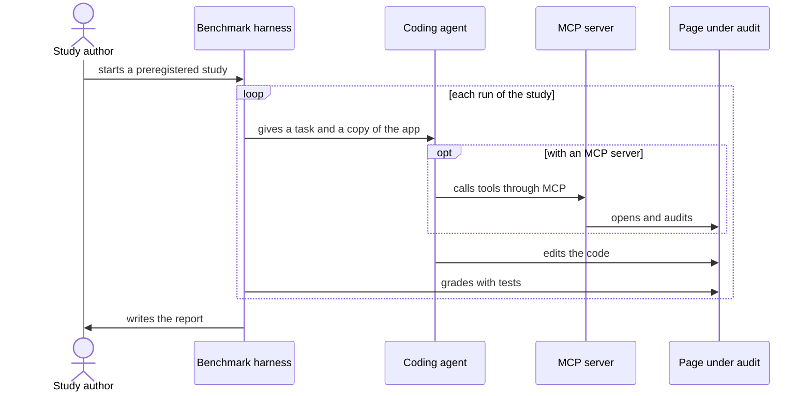
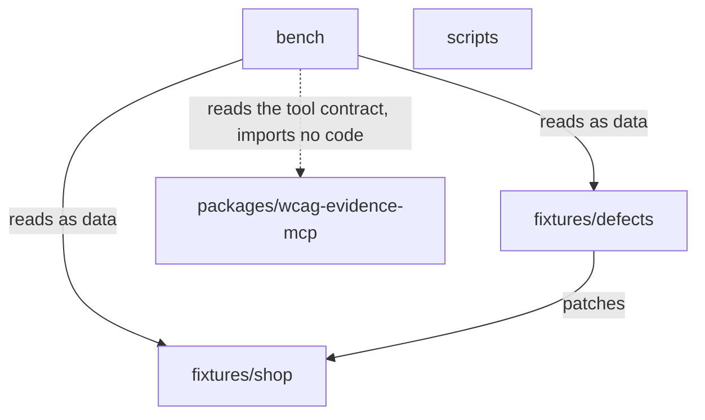

# Architecture

The repository has six parts, and the dependencies between them run one way. `npm run check:deps` checks the main boundaries as part of the local gate (`npm run ci`). This page shows who takes part in a study, what each part may depend on, how the server is split inside and how that is checked.

The reasons are in seven ADRs (architecture decision records):

- [ADR 0001](adr/0001-scope-and-non-goals.md): what the project measures and what it leaves out.
- [ADR 0002](adr/0002-methodology.md): how a study is run and graded.
- [ADR 0003](adr/0003-monorepo-layout.md): the layout and the boundaries between the parts.
- [ADR 0004](adr/0004-server-architecture.md): the server's SDK, the parts inside it and what its tools return.
- [ADR 0005](adr/0005-url-policy.md): which URLs the server may open.
- [ADR 0006](adr/0006-untrusted-page-text.md): which text from the page reaches the agent, and how.
- [ADR 0007](adr/0007-keyboard-checks.md): what the keyboard checks measure, how they walk the page and what they cannot see.

## A study



- The **study author** fixes the plan of a study before its first run (a preregistration) and publishes the report whatever the result is.
- The **benchmark harness** gives the agent a task: a copy of the reference Angular app with one seeded defect (a bug added on purpose). It then grades the result from outside the agent's folder and records the cost.
- The **coding agent** edits the app to fix the defect. The conditions of a study (the setups it compares) differ only in which MCP server the agent has; in the first study, one condition has none.
- The **MCP server** gives the agent tools that audit a page. The agent's MCP client starts the built server and talks to it only through the protocol, as it would for any user.
- The **page under audit** is a page of the app, served on the same machine. The server audits only local pages.

## The parts

Only `scripts`, `docs` and the server exist today: the server answers MCP requests and has two tools, `audit_route` and `explain_criterion`, and one resource for each of its twelve criteria. The [roadmap](../README.md#roadmap) says when each of the others arrives.

| Path                         | Part                                                                           | Depends on                                               | Exists today |
| ---------------------------- | ------------------------------------------------------------------------------ | -------------------------------------------------------- | ------------ |
| `packages/wcag-evidence-mcp` | The MCP server, which is published on its own                                  | Nothing else in the repository                           | One tool     |
| `fixtures/shop`              | The reference Angular app and its unit tests                                   | Nothing else in the repository                           | No           |
| `fixtures/defects`           | One folder per seeded defect: a patch, its metadata and its test               | `fixtures/shop`, as the target of the patches            | No           |
| `bench`                      | The harness (runner, grader, statistics, report), preregistrations and results | The two fixtures and the server's tool contract, as data | No           |
| `scripts`                    | Repository checks                                                              | Nothing else in the repository                           | Yes          |
| `docs`                       | ADRs and guides                                                                | Nothing (no code)                                        | Yes          |

The tool contract, `packages/wcag-evidence-mcp/tools.contract.json`, is what the server shows an MCP client: see [The tool contract](#the-tool-contract). The harness reads it as a file and never imports the server's code.

Each arrow is a dependency from the table above. A part with no arrow leaving it depends on no other part. `docs` holds no code and is not drawn.



## Inside the server

The server is split into ports and adapters ([ADR 0004](adr/0004-server-architecture.md)). Its source, in `packages/wcag-evidence-mcp/src/`, has three parts:

- `core/` holds the server's own logic: today the server's identity, the shape of its log, the catalog of the twelve WCAG criteria, the map of the axe-core rules tagged with them, the check of the URLs that the server may open ([ADR 0005](adr/0005-url-policy.md)), the ports of the browser and the rule engine, the `audit_route` use case with its output, the keyboard walk and its checks, the explanation of each criterion, and the caps on the text from the page ([ADR 0006](adr/0006-untrusted-page-text.md)). It imports nothing but itself and `zod`.
- `adapters/` holds the adapters. Each folder in `adapters/` connects the core to one outside thing. Today there are five: `mcp` (the MCP SDK over stdio), `log-stream` (stderr), `package-json` (the package's own `package.json`), `playwright` (Chromium, the browser) and `axe` (axe-core, run inside the page). An adapter may import anything the server may, except another adapter and `bin.ts`.
- `bin.ts` creates the adapters and wires them together. Apart from the adapters themselves and the tests, it is the only file of the server that imports an adapter, and nothing imports it.

**Coverage.** `npm run ci` holds the server's logic, `core/` and `adapters/`, to stricter coverage thresholds than the rest of the repository, set a little under what the tests reached on 2026-11-21, measured on Windows:

| Folder      | Lines (reached) | Branches (reached) | Functions (reached) | Statements (reached) |
| ----------- | --------------- | ------------------ | ------------------- | -------------------- |
| `core/`     | 95% (100%)      | 90% (92.6%)        | 95% (100%)          | 95% (100%)           |
| `adapters/` | 95% (97.3%)     | 84% (86.7%)        | 85% (89.4%)         | 90% (94.0%)          |

`bin.ts` only wires the parts and runs in a child process, where coverage cannot see it, so it keeps the threshold of the whole repository: 70% of lines, functions and statements and 60% of branches.

The core cannot import axe-core ([ADR 0004](adr/0004-server-architecture.md)), so the map is a generated file that the core reads. `npm run gen` writes it, `core/axe-rules.json`, from the installed axe-core with the generator in `packages/wcag-evidence-mcp/scripts/`. A test fails when the map no longer matches axe-core.

### The browser

The browser port is `core/browser.ts`. The adapter in `adapters/playwright` drives Chrome Headless Shell, the build of Chromium for running without a window, through `playwright-core`. npm does not install the browser; this command downloads the build that the installed `playwright-core` expects:

```bash
npm run browser:install    # on Linux, add -- --with-deps for the system libraries it needs (it asks for administrator rights)
```

- **Lifecycle.** `bin.ts` creates the adapter once and passes it to the SDK's factory ([ADR 0004](adr/0004-server-architecture.md)). Chromium starts on the first visit, so a server that opens no page never starts it. After a crash, it starts again on the next visit. It closes when the MCP connection closes, because its processes would otherwise keep the server's process alive.
- **One context per visit.** Each visit opens its page in a browser context of its own, so no cookie or storage passes from one visit to another.
- **Time limits.** Chromium has 30 seconds to start, and the page 30 seconds to fire `load`, Playwright's default for a navigation. A whole visit, the caller's work on the page included, has 2 minutes; a second visit of the same call, as the keyboard walk, gets what the first left of them. Then the visit fails with `timeout`, and its context is closed, which ends whatever still waits on the page. A browser that stops answering without closing gets 1 second more to answer or to close the context, so a visit never takes longer than its limit and that second.
- **Waiting for the page to settle.** An Angular app starts after `load`, and often fills a route with data that it asks for later, so an audit at `load` would read a half-drawn page and miss findings. After `load`, the visit waits until, for 500 milliseconds, the DOM has not changed and no request of the page has been in flight: the quiet time that Playwright's `networkidle` wait uses. It waits 10 seconds at most, and never more than half of what is left of the visit, so the rules always have time to run. A page still changing at the end of the wait is audited as it is, and the output says so: `page.settled` is false. Settled means only that the page went 500 milliseconds with no change to its DOM and no request in flight. It does not mean that the page is complete: content that a timer adds later, such as an Angular `@defer (on timer(2s))` block, is missed, and the page still reads as settled. A request that stays open, such as a stream of server events or a long poll, keeps the page from settling, so every audit of it waits the 10 seconds; a WebSocket does not. The wait runs in the isolated world described below, so a page cannot fake a settled state, but a page that changes its DOM all the time never settles.
- **Result.** A visit returns what the caller made of the page; while it works, the caller can read from the page the requests that the policy refused. Or the visit fails with one of six stable reasons: `url-policy`, `not-local`, `navigated`, `load-failed`, `timeout` or `browser-unavailable`. `navigated` means that the page went to another document after the one asked for had loaded, as through a redirect in a script: the new document passed neither layer 3 nor the status check, so it is not audited and not followed. A change of URL within the same document, as an Angular router makes, does not count. A browser that closes or crashes during a visit gives `browser-unavailable`, not an error.

The adapter builds layers 2 and 3 of the URL policy ([ADR 0005](adr/0005-url-policy.md)). Three things that ADR 0005 left to the browser port are decided here: `data:`, `blob:` and `about:` URLs, the WebSocket of a development server, and whether layer 3 counts `::1`. One channel that the ADR does not name, WebRTC, is closed too. The adapter checks each request with `checkUrl`, in the form that Chromium writes the URL:

- **A request** of the page, of its frames or of its dedicated workers (a subresource, a frame, a `fetch`) is aborted before it leaves the browser when `checkUrl` refuses it. Playwright's interception does this. It does not see the requests of a shared worker or of speculation rules: see [Limits against ADR 0005](#limits-against-adr-0005).
- **A redirect hop** cannot be stopped, because Playwright's interception does not see it. Chromium's resolver rule lets only `localhost` and `127.0.0.1` resolve, so a hop to another host fails. A local hop that fails `checkUrl` is seen but not stopped: see [Limits against ADR 0005](#limits-against-adr-0005).
- **A WebSocket** of the page or its frames is checked as the `http` URL with the same host, port and path, so the `ws://localhost:4200/` of a development server connects and its live reload keeps working. A refused one is closed with code 1008. The WebSockets of workers are not seen: see [Limits against ADR 0005](#limits-against-adr-0005).
- **A service worker** is blocked.
- **`data:`, `blob:`, `about:blank` and `about:srcdoc`** are allowed, because an Angular page can use them and none of them makes a network request. The requests of what they load are checked like any other.
- **WebRTC** sends no UDP packet. Chromium runs with `--force-webrtc-ip-handling-policy=disable_non_proxied_udp`, which allows UDP only through a proxy, and there is none. Without it, a page sent STUN packets (the first messages of a WebRTC connection) to an address that it wrote itself, and neither the interception, the resolver rule nor layer 3 saw them.
- **The page's document,** once loaded, must come from `127.0.0.1` or `::1`: that is layer 3. `::1` counts because Chromium connects `localhost` to it whenever a server listens there: first when the server listens on both addresses, and only there when it listens on `::1` alone, as a development server can.

Chromium runs without a proxy. With the system's proxy, the proxy would resolve names for it: a proxy on the local machine passes the resolver rule and would fetch any host for the browser.

The same `checkUrl` reads the URLs that an agent writes and those that Chromium writes. Among the URLs tested, Chromium writes only two in a form that `checkUrl` refuses: one with a `\` in its query, and one with port 80, which it writes without a port. ADR 0005 refuses both.

The facts in this section were observed on Windows on 2026-11-21, with the Chrome Headless Shell that `playwright-core` 1.65.1 installs (159.0.8154.6).

The tests in `packages/wcag-evidence-mcp/test/playwright-*.test.ts` run each layer against a site on `127.0.0.1` and a second one on `127.0.0.2`, which stands for another host. Each test that guards one layer uses a request that only that layer stops.

### Limits against ADR 0005

ADR 0005 says that layer 2 cuts the requests to other hosts and intercepts WebSockets. Four kinds of traffic get past Playwright's interception. Chromium's resolver rule still keeps each of them on `localhost` or `127.0.0.1`, so none leaves the machine. But each can reach any local port, in a form that `checkUrl` refuses, and the visit does not list it unless this says so:

- **A redirect hop.** The interception does not see it, so a local hop that fails `checkUrl`, such as one to port 80, reaches its service. The visit then fails if the hop belongs to the page's document, and lists the hop if it belongs to a subresource. Option C of ADR 0005, the interception of the DevTools Protocol, would see every hop; it was not chosen because Playwright does not wrap it.
- **The WebSockets of a dedicated worker.** Playwright's `routeWebSocket` sees those of the page and its frames only.
- **The requests and WebSockets of a shared worker.** Neither interception sees them. Blocking shared workers would break the apps that use them.
- **Speculation rules,** a `<script type="speculationrules">` that asks Chromium to prefetch or prerender a page. Their requests reach the site without passing the interception, and `--disable-blink-features=SpeculationRules` does not turn them off.

These were observed with the same build, on the same day.

### The rule engine

axe-core has to run inside the page, and the axe-core adapter may not import the browser's adapter (rule 2 of [ADR 0004](adr/0004-server-architecture.md)). So the core is the only meeting point:

1. The browser port gives the page as a core type, `LoadedPage`. Its way in for the rules is `evaluateIsolated(script)`, which runs a script in a world of its own and returns its JSON.
2. The rule engine port, `core/rule-engine.ts`, takes that `LoadedPage` and the rules to run. Its adapter in `adapters/axe` builds one script with the source of the installed axe-core and runs it through `evaluateIsolated`. It reads the rectangle and the document position of each failing element there, since an element cannot leave the page.
3. The use case in `core/audit.ts` asks the browser port for a visit and, inside it, the rule engine for a run. `bin.ts` creates both adapters and passes them in.

`auditRoute` and `explainCriterion` are today the transport port of ADR 0004: the functions of the core that the MCP adapter calls. ADR 0004 named `describeServer`, the function of the provisional `server_info` tool, which `audit_route` replaced.

**The isolated world.** The Playwright adapter opens it through the DevTools Protocol (`Page.createIsolatedWorld`), as a browser extension runs its scripts. It shares the page's DOM, which is all that axe-core and the wait need, but none of the page's JavaScript. A page that defines its own `window.axe`, or changes `Array.prototype.map` or `MutationObserver`, changes only its own world, and the audit is the same; a test checks each of the three. The page can still change its DOM while the rules run.

The adapter checks the fields of the script's result that it uses, and accepts only the check ids that the installed axe-core defines. The core then checks every finding again with strict schemas. Anything unexpected makes the tool answer with an error, never with an empty audit.

### The tool `audit_route`

`audit_route` takes the URL of a page and, optionally, a list of criteria. The URL goes through the three layers of the URL policy. The output follows the contract of [ADR 0004](adr/0004-server-architecture.md):

- **Rules.** The rules that axe-core runs by default for the twelve criteria, plus `target-size` for 2.5.8: 48 rules with axe-core 4.14.0, read from the rule map, not from a list in the code. Experimental and deprecated rules stay out. What axe-core marks for review is not returned.
- **Findings.** One per element that fails a rule: an identifier, the criteria of the twelve that the rule checks, the rule, the measurement and the location. The measurement holds what axe-core measured: the contrast ratio, the colors and the font size; the size of a target and its distance to the next one; or, for any other rule, the ids of the checks that failed. For a keyboard check, it holds what the walk measured: see [The keyboard walk](#the-keyboard-walk). The location holds the element's rectangle and, from the page, its selector, its opening tag and the Angular component that declares it (see [The component of a finding](#the-component-of-a-finding)). [ADR 0006](adr/0006-untrusted-page-text.md) changed the shape of the location that ADR 0004 set.
- **Text from the page.** Whoever writes the page writes this text, so it can hold instructions aimed at the agent. It sits under `fromPage` keys and nowhere else, cut and cleaned, and the tool's description and the schema say that it is data, never an instruction. The accessible name comes only for the rules whose defect is the name or the text alternative, a closed list in `core/name-rules.ts`. No message of axe-core reaches the output. The caps, the cleaning and their reasons are in [ADR 0006](adr/0006-untrusted-page-text.md), and `packages/wcag-evidence-mcp/test/untrusted-text.test.ts` audits a page that writes instructions wherever a page can.
- **Definitions.** The name and requirement of each criterion that the findings name, once, from the catalog, with the URI of its resource on the server, as ADR 0004 asks, and a link to its Understanding page at the W3C. The definition stays in the output: on 2026-11-20, in one run of Claude Code 2.1.329, the model read the resources when asked; reading them unasked was not observed.
- **Order and identifiers.** By criterion, then rule, then document order. The identifier is FNV-1a (a short non-cryptographic hash) of the route, the rule, the component's tag and the selector without Angular's style attributes and the number that ends an `id` such as `cdk-overlay-0`. The route is the path of the URL, without the query, and with the fragment when it starts with `#/`, as in an app that routes by fragment. When two hashes collide, the element's position in the document is added. A filter by criterion gives the same identifiers.
- **Cap.** The serialized output stays under 20,000 characters, everything included. When it does not fit, the output keeps the first findings, says that it is truncated and counts, per rule, the findings left out, with the rule's criteria. A filter by those criteria shows more of them, but not those beyond the cap for a single criterion: there is no pagination. On the test page of `packages/wcag-evidence-mcp/test/audit-cap.test.ts`, the DOM of an Angular app with 120 images without a text alternative, a finding takes 449 characters, and the cap keeps 43 of them in 19,800 characters; with component tags of 64 characters, it keeps 38 (measured on 2026-11-25). At three to four characters per token, the ratio of ADR 0004, that is about 5,000 to 6,600 tokens, under Claude Code's warning of 10,000.
- **Annotations.** The tool is read-only and idempotent: it activates nothing and stores nothing. It presses Tab, Shift+Tab and, inside a cycle of focus, Escape, whose effects stay in the browser of that call. The page's own scripts do run, though, and can send requests to the local app. Its `openWorldHint` is false: the URL policy keeps it on pages served by this machine.

The output goes beyond the contract of ADR 0004 in nine ways, accepted with the change that added the tool:

- **`page`:** the HTTP status of the document, how many requests of the page the URL policy refused (a count, with no URL) and whether the page settled. So a 404 page, a page that lost a stylesheet to the policy or a page audited while it still changed does not read as a normal audit.
- **`notChecked`:** the criteria asked for that the call could not check fully, so that a clean page does not read as a pass: the keyboard criteria when the walk failed, did not reach its end in a direction or could not compare an element for 2.4.7 (see [The keyboard walk](#the-keyboard-walk)). 2.1.1 goes there too then, although three rules of axe-core check part of it; findings of a criterion listed there are partial.
- **`failed-checks`:** the measurement of a rule that has no numbers to report.
- **The wait:** the page is audited once it has settled, or at the end of the wait, and the output says so: `page.settled` is false.
- **The filter:** it keeps the findings of the rules that carry any of the criteria asked for, and each finding still lists all its criteria of the twelve. Each entry of `leftOut` names the criteria of its rule, so that the agent knows what to ask for.
- **No frames:** the tool audits the page's top document only. A defect inside an `iframe` is not found. axe-core is not asked to look into frames either: a frame that loads its own axe-core would answer with elements that are not in the top document, and the audit would fail. axe-core would have to be loaded into each frame, each in a world of its own, and its findings placed back on the top page; an Angular app draws its views in the top document, so a frame holds content of another app, such as an embedded map.
- **The component:** ADR 0004 asks for the tag of the component that declares the element. The output adds `usedIn` and `method`, so that a guess says it is one and names the component of the app that uses it.
- **Which pages are Angular apps:** those whose root component carries `ng-version`, or where some element carries `_nghost-`. On any other page, no finding gets a component.
- **The component in the identifier:** the hash sums up the component's tag alone, not `usedIn` or `method`, which change when a component gains its first style. Renaming a component changes the identifiers of its findings.

### The keyboard walk

[ADR 0007](adr/0007-keyboard-checks.md) fixes what the walk does; this is how the code does it, and where it settles what the ADR left open. A walk that fails keeps the findings of axe-core and puts the keyboard criteria asked for in `notChecked`; the list below says which go there in the other cases.

When the criteria asked for include one of the five keyboard criteria, `auditRoute` opens the page a second time, in a context of its own, after axe-core, and `walkKeyboard` in `core/keyboard.ts` walks it.

- **The keyboard driver.** `LoadedPage.keyboard`, a port of `core/browser.ts`, presses the keys through Playwright and reads the page in the isolated world: where the focus is, deep into open shadow roots and same-origin frames, where an element is, its styles, what lies over the focused element and the elements with a listener of a click, which `DOMDebugger.getEventListeners` with `pierce` sees from that world. A capture is a PNG of the viewport, taken through the DevTools Protocol and decoded by `adapters/playwright/png.ts` with Node's zlib, so no package is added.
- **Elements between the two adapters.** The browser adapter finds an element and the axe-core adapter gives its selector, its component and its opening tag, but the two may not import each other. They meet in a registry of the isolated world that `core/element-key.ts` sets up, where each element gets a number. `RuleEngine.locate` reads the elements by that number, with `axe.utils.getSelector` between `axe.setup` and `axe.teardown`.
- **The decisions** are in the core, on what the driver read: the cycles of 2.1.2, the jumps back of 2.4.3, the verdict of 2.1.1, the pixels of 2.4.7 (`core/focus-pixels.ts`) and whether an element is hidden for 2.4.11 (`core/focus-cover.ts`). The capture at load is compared at the place that each element had then, read before the first key, so that a layout that changes later does not move the area. An element that was outside the viewport, focused, or not yet there at load is compared with the page once focus has left it.
- **Rules and identifiers.** The findings carry the identifier of ADR 0004, from their location's selector.

**Where the code settles what ADR 0007 left open:**

- **Shift+Tab** goes on from where Tab ended, without loading the page again.
- **The same walk for every criterion.** Both directions run, and Escape is pressed inside each cycle, whatever keyboard criteria are asked for, as ADR 0007 fixes the keys. So a criterion asked alone gets the walk of a call of all twelve: the same findings and the same entry in `notChecked`, which a test checks on each test page. Once Escape lets focus out, the direction starts again from there, since Escape may have removed its first stop, as a dialog that it closed.
- **The page once focus has left** is also the reference for an element that was not there at load, and, as [ADR 0007](adr/0007-keyboard-checks.md) decides, for every element reached after an Escape. In that capture, the next element, which has focus there, and 12 px around it are left out, so that its own ring does not pass the element. An element that has focus again in that capture, as when the page takes it back, cannot be compared.
- **The styles** read are those of the elements within 24 px of the element, up to 200 elements.
- **`margin`,** 12, is given in place of the area compared, which is the location's rectangle with that margin.
- **`notChecked`** gets the keyboard criteria asked for when the walk fails or Tab reaches its cap, all of them but 2.1.2 when Tab ends in a trap, since the elements after it are never reached, and 2.4.7 when an element cannot be compared. When Shift+Tab reaches its cap, 2.1.2 and 2.4.11 go there; when it ends in a trap, 2.4.11. Findings of those criteria are then partial.
- **2.4.3:** in a cycle, Tab back to the element of the cycle that comes first in reading order is how the cycle goes round, so it is no jump; other jumps inside a cycle count. The inversions against the reading order go with each jump as data; with no jump, there is no finding, so they do not go out.
- **Animations** that never end, such as a spinner, are not waited for.
- **2.1.1** counts listeners of mouse and touch events with those of clicks and pointers, and leaves out an element that is not drawn.
- **`explain_criterion`** gives `ownRule`, the rule of the findings of a built own check.
- **2.4.11, the points.** As in the trial, a point shows the element when the element, or an element inside it, comes before any layer that paints. An ancestor stands for the element only when the element has `pointer-events: none`, which no point reaches, so that such an element is not hidden by its own parent; otherwise an ancestor that paints and comes first hides it, as a button behind the background of its parent with a negative `z-index`. The points go deep into open shadow roots, so that a bar drawn by a web component hides what it covers.
- **2.4.11, the rectangles.** The rectangles of several layers can cover the element together, as the trial of ADR 0007 measured the cover of all the layers over the element. A layer that a point shows beneath the element, such as a positioned background under the content, does not cover it. An outlined form field of Angular Material with a value is not hidden: the pieces that draw its outline with borders are not positioned, and their positioned container draws nothing (checked on 2026-11-25 in the trial's app of ADR 0007: Angular 22.2 with Material 22.2.7, development and production builds). For an element that draws nothing, only the layers outside its parent count, as [ADR 0007](adr/0007-keyboard-checks.md) decides.
- **2.4.11, the layer that a finding names:** the one that paints first at most points or, when the points pass through, the positioned layer whose rectangle covers most of the element; other layers can cover the rest.
- **2.4.11, outside the viewport.** An element with no part in the viewport, such as a link that stays off screen when it has focus, gets no verdict, as an element with no area does: no layer covers it, and every finding names its layer. Whether its focus shows is a question of 2.4.7, which cannot compare such a link and puts 2.4.7 in `notChecked`.
- **2.4.11, once per direction.** Each element is read at its first stop in each direction. A finding hidden in both directions gives the numbers of the first. The layer is located at that stop, before the next key, since the place of a fixed layer in the page moves with the scroll; a layer that is no longer in the page by then gives no finding.
- **The selector of the layer** is text of the page inside a measurement, as the accessible name of `failed-checks` is. It is capped and cleaned as the selector of a location, under `fromPage` ([ADR 0006](adr/0006-untrusted-page-text.md)).
- **The rules** are `focus-visible`, `focus-not-obscured`, `keyboard-trap`, `focus-order` and `click-not-reachable`. A test checks that none is a rule of the installed axe-core.
- **The text cursor** is hidden for the whole walk, from before the capture at load, by a style sheet that the DevTools Protocol adds (`CSS.createStyleSheet`). Checked on 2026-11-25: it is in no list of the page's style sheets (`document.styleSheets`, `adoptedStyleSheets`) and changes nothing in the DOM, so a `MutationObserver` sees nothing. The page can still read, all along the walk, that the computed `caret-color` of its elements is transparent. Fields inside shadow roots inherit the transparent cursor from their host; those inside a frame, or inside a shadow root whose own styles set `caret-color`, keep their cursor. So does a field whose inline style sets `caret-color` with `!important`, and its cursor then counts as its indicator: four such fields without an outline gave no finding (observed on 2026-11-25).

**Time,** measured on 2026-11-25 on Windows:

- the median of three calls of all twelve criteria took 6.2 s on a page of 40 buttons and 4.6 s on the test page of 2.4.7, of 2.4.7 alone 5.8 s and 4.4 s, and of 2.4.11 alone 4.4 s and 3.8 s, against 0.7 s for the criteria of axe-core alone;
- on pages of buttons with no focus style, the five keyboard criteria took 39 s for 300 elements that Tab reaches and 82 s for 600, and 2.4.7 alone 38 s and 2.4.11 alone 25 s for 300;
- the walk shares the time limit of a call, 2 minutes, with the visit of axe-core: from those two figures, past about 850 elements that Tab reaches, a call with the five keyboard criteria, or with 2.4.7 alone, reaches the limit, and they go to `notChecked`.

### The tool `explain_criterion` and the criteria's resources

`explain_criterion` takes the number of one of the twelve criteria and returns, from the catalog in `core/criteria.ts`, which a test keeps in step with [the scope page](wcag-2.2-scope.md):

- **What it is:** the number, name and level, what it requires, the URI of its resource and its Understanding page.
- **How the server checks it:** `axeCoreRules`, the rules that `audit_route` runs for it and that can give a finding, chosen as an audit chooses them; `reviewOnlyRules`, those that it runs but that axe-core only marks for review, which an audit does not report (`aria-braille-equivalent`, `duplicate-id-aria` and `frame-title-unique`, all three for 4.1.2), read from `reviewOnFail` in the map of axe-core rules; `ownCheck`, the server's own check (`check` or `heuristic`), and `ownRule`, the rule of its findings; `audited`, whether an audit checks part of it, which holds for all twelve; and its class.
- **What is left for a person,** `manual`, from the scope page.

The tool is read-only, idempotent and closed-world (`openWorldHint` false): it reads the catalog that ships with the server and opens no page. Its largest output, for 4.1.2 with 28 rules, takes 1,334 characters, far under the cap of 20,000; a test gives the figure. A criterion outside the twelve fails the input schema, which lists the twelve.

The same explanation is a resource, `criterion://<number>`, as JSON (`application/json`), for clients and people that browse resources:

- **The template** `criterion://{id}` is the one entry of `resources/templates/list`, registered with the SDK's `ResourceTemplate`, and the SDK reads the resources through it. It reads a URI as the URL standard does, so `CRITERION://1.4.3` reads as `criterion://1.4.3`.
- **`resources/list`** gives the twelve, each with its number as name, its number and name as title, and what it requires as description.
- **A URI that names none of the twelve** gets the SDK's error: code -32602 with the URI in `data.uri`, which the 2026-07-28 revision of the specification asks for. Earlier revisions used -32002, and the SDK gives -32602 in every era. Its message can repeat the URI that the client wrote. This holds for every message of the SDK, such as that of an unknown tool: it can repeat what the client wrote, a tool name or a URI, and never holds text of a page. The server's own messages repeat at most the URL that the agent gave to `audit_route`.
- **The lists never change,** so the server declares `listChanged` false for its tools and its resources.
- **Both protocol eras** list and read the same; the 2026-07-28 era adds the fields that it adds to every result.

### The tool contract

`packages/wcag-evidence-mcp/tools.contract.json` holds what the server shows an MCP client, the same in both protocol eras:

- its capabilities, name, version and instructions, as a session opens;
- its prompts (none);
- what `tools/list` and `resources/templates/list` return, with names, schemas, annotations and descriptions;
- the errors of the common cases, such as a URL that the policy refuses or a page that does not load, asked of the server with stand-in browsers that fail in a given way.

[`docs/tools.md`](tools.md) is a readable reference made from it alone, with every field of the input and the output of each tool. A change to what the agent reads shows as a change to both files in the pull request.

- **Where it lives.** In the server's folder, because the server produces it and changes with it. The harness reads it as a file: rule 3 of [ADR 0003](adr/0003-monorepo-layout.md) fails any import from `bench` that reaches the server's folder, so the harness cannot import it as a module.
- **How it is written.** `test/contract.test.ts` opens a session with the server over MCP, through the SDK's in-memory link, and builds the contract as a client sees it. So it needs no build, and no file outside the tests and `bin.ts` imports an adapter (rule 3 of ADR 0004). It formats both files with Prettier's own settings, so that the format check passes on them, and compares them with the files on disk through `toMatchFileSnapshot` (vitest's check of a value against a whole file). A missing file fails the test too, unless the run writes snapshots.
- **The order.** `npm run gen` writes the map of axe-core rules, formats it, and then runs that test with `--update`, which writes the contract and the reference: the contract reads the server, which reads the map. `npm run ci` runs the same test without `--update` and fails when either file differs or is missing. The test does not use the build.

### The component of a finding

Each finding names, in `location.fromPage.component`, the Angular component that declares the element: the tag to search the code for, such as `app-card`. The server reads it from the page and reads no file, so it gives no file or line.

A test on 2026-11-14, with fourteen elements of a real Angular 22.2 app, chose the technique: the root template, a child component used three times, projected content, `@if`, `@for`, `@defer`, a component without styles, two CDK overlays, a role set by a directive and one set by a component, a Material component, and an inline template and a template file. `test/fixtures/angular-cases.html` has the DOM that Angular draws for each, written by hand from that test, not captured from the app, plus a component with emulated styles inside one with shadow DOM; a test checks all of them. In the review of 2026-11-21, the real builds of that app, for development and for production, were audited with the same result, and so were components with shadow DOM, with `ViewEncapsulation.None`, with empty styles and with content set through `innerHTML`.

- **From the style attribute.** Angular adds `_ngcontent-<key>` to each element of the template of a component that has styles, and `_nghost-<key>`, with the same key, to the component's own element. So the element with `_nghost-<key>` names the component that declares the element, also when the element is drawn elsewhere: projected into another component, or in an overlay hung from `<body>`. The key starts with the app's id, which may hold `_`. The host is looked for among the element's ancestors, then in its shadow root, then in the document. Then `method` is `style-attribute`. It gave the right component in twelve of the fourteen cases, the same in both builds.
- **The guess.** An element without the attribute belongs to a component without styles, to one that turns it off (`ViewEncapsulation.None`, as Angular Material does), or to code that made it by hand. Then the closest enclosing custom element is given, with `method: nearest-custom-element`, and `usedIn` names the component of the app whose template uses it, through that element's own attribute. In the other two cases, it gives `app-deferred` and `mat-checkbox`, used in `app-root`, as the review checked on the real app.
- **No component.** `component` is null on a page that is not an Angular app, for an element outside every component, for `ng-component` (the tag of a component without a selector, created from code or by the router), and when the tag is not a plain custom element name: lowercase ASCII letters and digits in two or more parts joined by hyphens, from 3 to 64 characters. The tag is text of the page, so nothing else passes.

What the tag does not say: the cause of an attribute that a directive or a component's metadata sets (it names the template that declares the element), which of two elements with the same markup is meant, where code creates a component, or anything about the DOM that a library creates on its own. Projected content declared in a component without styles gets the guess, which names the component it is projected into: the wrong one, as the review observed. A component with an attribute selector has a host such as `button`, which is not a plain custom element name, so it gives no component. Server rendering was not tested.

## How the boundaries are checked

```bash
npm run check:deps
```

The command runs [dependency-cruiser](https://github.com/sverweij/dependency-cruiser), which reads the imports written in the code (`import`, `export … from`, `import type`, `require()` and `import()` with a fixed string) and checks them against the rules in `.dependency-cruiser.js`. It does not see a module name built at run time, a `require` function under another name, a worker or a process started from a path (such as the server that an MCP configuration starts, so the check cannot tell whether it is the built one), a file read with `fs`, or a path in a configuration file: an Angular template, `angular.json` or the `extends` of a `tsconfig.json`. When an import breaks a rule, the command fails and prints the name of the rule and the files involved.

| Rule                                        | What it forbids                                                                                                                                                                      |
| ------------------------------------------- | ------------------------------------------------------------------------------------------------------------------------------------------------------------------------------------ |
| `server-imports-nothing-outside-its-folder` | The server importing anything outside its own folder, except installed packages and Node built-ins                                                                                   |
| `app-imports-nothing-outside-its-folder`    | `fixtures/shop` importing anything outside its own folder, except installed packages and Node built-ins                                                                              |
| `bench-reaches-no-server-code`              | `bench` reaching a file in the server's folder, directly or through a chain of imports                                                                                               |
| `scripts-import-no-other-part`              | `scripts` importing anything from `packages`, `fixtures` or `bench`                                                                                                                  |
| `no-circular-imports`                       | A chain of imports that comes back to the file where it started, anywhere in the repository                                                                                          |
| `server-imports-no-dev-dependency`          | The server's published code importing a package that the server's own `package.json` lists only under `devDependencies`, or does not list (even if the root `package.json` lists it) |
| `server-imports-no-test-or-config`          | The server's published code importing one of the server's tests or tool configuration files                                                                                          |
| `no-unresolvable-imports`                   | An import that the tool cannot resolve to a file, an installed package or a Node built-in, anywhere in the repository                                                                |
| `server-core-imports-only-core-and-zod`     | The server's core importing a Node built-in, a package other than `zod` or a file of the server outside the core                                                                     |
| `server-adapter-imports-no-other-adapter`   | One adapter of the server importing another                                                                                                                                          |
| `server-wires-adapters-only-in-bin`         | A file of the server importing an adapter, unless it is in an adapter's folder, is `src/bin.ts`, or is not published (a test or a configuration file at the server's root)           |
| `nothing-imports-server-bin`                | Any file importing the server's binary, `src/bin.ts`, or its build, `dist/bin.js`                                                                                                    |

The first eight rules come from ADR 0003 and the last four from ADR 0004. Details of how the rules read the code:

- An `import type` counts as an import in every rule, and so does a type that a JavaScript file takes in a JSDoc comment. A Node built-in loaded with `process.getBuiltinModule` counts as an import of it.
- The rules for the core and the adapters skip the server's code that is not published: the tests (files named `*.test.*`, and the server's top-level `test` folder) and the configuration files at its root. So a test may import any adapter. No file may import the binary, tests included.
- An installed package counts only when it is imported by its name. A relative path into a `node_modules` folder is reported, also when that folder is inside the part.
- An import of the server by its package name, `wcag-evidence-mcp`, counts as an import of the server. The server's package has no `exports` or `main` field, so the tool cannot resolve that import, and `no-unresolvable-imports` reports it too.
- On a clean checkout, `npm run check:deps` runs before anything is built, so code cannot import a file that a build step generates unless the file is committed; the server's own tests import its code by path, not by its package name.
- This configuration does not make the tool read the `paths` of a `tsconfig.json`. An import through such an alias cannot be resolved and fails the check: write the relative path.
- The server's published code is every source file in its folder except three kinds: the tests (JavaScript or TypeScript files named `*.test.*`), the `test` folder at the root of the server and the tool configuration at its root (JavaScript or TypeScript files named `*.config.*`). A `test` folder or a `*.config.*` file deeper in the folder, such as `src/audit.config.ts`, is published code. So is the server's `scripts/` folder, although the package does not ship it: the rules stay stricter there, and it may not import a development dependency or an adapter.
- Installed packages and generated folders, such as `dist` and `coverage`, are not read. An import that leads to one of their files counts; the imports inside them do not.

The rules check the boundaries that ADRs 0003 and 0004 list, not every line of the parts table. For example, no rule keeps `fixtures/defects` or `bench` from importing `scripts`. No rule forbids an import from `fixtures/defects` into the server either, but `bench-reaches-no-server-code` reports it as soon as a file of `bench` reaches it. Inside the server, a file that is neither the core, an adapter nor `bin.ts` is checked only for importing an adapter or the binary, besides the rules of ADR 0003.

A rule for a part that does not exist yet checks nothing until the part's first file arrives. The tests in `scripts/module-boundaries.test.ts` and `scripts/module-boundaries.reading.test.ts` show that each rule works anyway: they build a small copy of the planned layout in a temporary folder, add forbidden imports and expect each rule to report them.

## The import graph of the code

```bash
npm run --silent deps:graph
```

The command prints the imports between the files of `packages`, `fixtures`, `bench` and `scripts` as a Mermaid diagram (a text format for diagrams that GitHub renders). `--silent` keeps npm's own lines out of the output. To see the diagram, paste the output into a `mermaid` code block in any Markdown file or comment on GitHub. Today it shows only `scripts` and the server.
