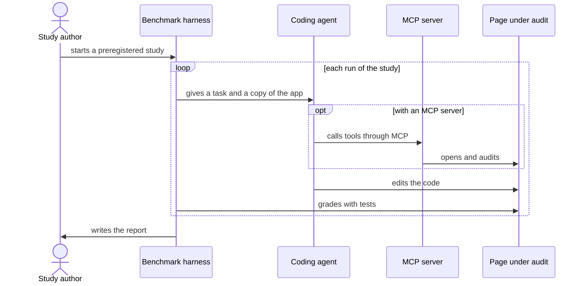
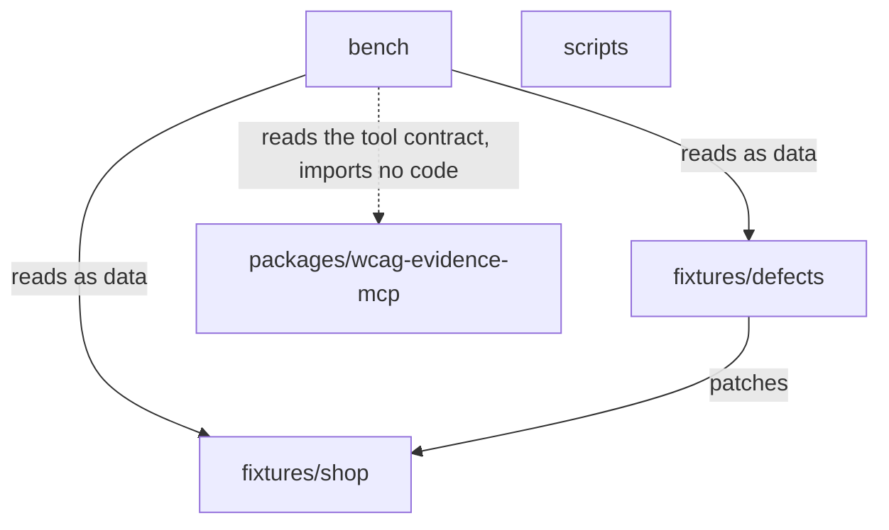

# Architecture

The repository has six parts, and the dependencies between them run one way. `npm run check:deps` checks the main boundaries as part of the local gate (`npm run ci`). This page shows who takes part in a study, what each part may depend on and how that is checked.

The reasons are in three ADRs (architecture decision records):

- [ADR 0001](adr/0001-scope-and-non-goals.md): what the project measures and what it leaves out.
- [ADR 0002](adr/0002-methodology.md): how a study is run and graded.
- [ADR 0003](adr/0003-monorepo-layout.md): the layout and the boundaries described here.

## A study



- The **study author** fixes the plan of a study before its first run (a preregistration) and publishes the report whatever the result is.
- The **benchmark harness** gives the agent a task: a copy of the reference Angular app with one seeded defect (a bug added on purpose). It then grades the result from outside the agent's folder and records the cost.
- The **coding agent** edits the app to fix the defect. The conditions of a study (the setups it compares) differ only in which MCP server the agent has; in the first study, one condition has none.
- The **MCP server** gives the agent tools that audit a page. The agent's MCP client starts the built server and talks to it only through the protocol, as it would for any user.
- The **page under audit** is a page of the app, served on the same machine. The server audits only local pages.

## The parts

Only `scripts` and `docs` exist today. The [roadmap](../README.md#roadmap) says when each of the others arrives.

| Path                         | Part                                                                           | Depends on                                               | Exists today |
| ---------------------------- | ------------------------------------------------------------------------------ | -------------------------------------------------------- | ------------ |
| `packages/wcag-evidence-mcp` | The MCP server, which is published on its own                                  | Nothing else in the repository                           | No           |
| `fixtures/shop`              | The reference Angular app and its unit tests                                   | Nothing else in the repository                           | No           |
| `fixtures/defects`           | One folder per seeded defect: a patch, its metadata and its test               | `fixtures/shop`, as the target of the patches            | No           |
| `bench`                      | The harness (runner, grader, statistics, report), preregistrations and results | The two fixtures and the server's tool contract, as data | No           |
| `scripts`                    | Repository checks                                                              | Nothing else in the repository                           | Yes          |
| `docs`                       | ADRs and guides                                                                | Nothing (no code)                                        | Yes          |

The tool contract is the generated list of the server's tools and their schemas. The harness reads it as a file and never imports the server's code.

Each arrow is a dependency from the table above. A part with no arrow leaving it depends on no other part. `docs` holds no code and is not drawn.



## How the boundaries are checked

```bash
npm run check:deps
```

The command runs [dependency-cruiser](https://github.com/sverweij/dependency-cruiser), which reads the imports written in the code (`import`, `export … from`, `import type`, `require()` and `import()` with a fixed string) and checks them against the rules in `.dependency-cruiser.js`. It does not see a module name built at run time, a `require` function under another name, a worker or a process started from a path (such as the server that an MCP configuration starts, so the check cannot tell whether it is the built one), a file read with `fs`, or a path in a configuration file: an Angular template, `angular.json` or the `extends` of a `tsconfig.json`. When an import breaks a rule, the command fails and prints the name of the rule and the files involved.

| Rule                                        | What it forbids                                                                                                                                                                      |
| ------------------------------------------- | ------------------------------------------------------------------------------------------------------------------------------------------------------------------------------------ |
| `server-imports-nothing-outside-its-folder` | The server importing anything outside its own folder, except installed packages and Node built-ins                                                                                   |
| `app-imports-nothing-outside-its-folder`    | `fixtures/shop` importing anything outside its own folder, except installed packages and Node built-ins                                                                              |
| `bench-reaches-no-server-code`              | `bench` reaching a file in the server's folder, directly or through a chain of imports                                                                                               |
| `scripts-import-no-other-part`              | `scripts` importing anything from `packages`, `fixtures` or `bench`                                                                                                                  |
| `no-circular-imports`                       | A chain of imports that comes back to the file where it started, anywhere in the repository                                                                                          |
| `server-imports-no-dev-dependency`          | The server's published code importing a package that the server's own `package.json` lists only under `devDependencies`, or does not list (even if the root `package.json` lists it) |
| `server-imports-no-test-or-config`          | The server's published code importing one of the server's tests or tool configuration files                                                                                          |
| `no-unresolvable-imports`                   | An import that the tool cannot resolve to a file, an installed package or a Node built-in, anywhere in the repository                                                                |

Details of how the rules read the code:

- An `import type` counts as an import in every rule, and so does a type that a JavaScript file takes in a JSDoc comment.
- An installed package counts only when it is imported by its name. A relative path into a `node_modules` folder is reported, also when that folder is inside the part.
- An import of the server by its package name, `wcag-evidence-mcp`, counts as an import of the server. While the server is not built, the tool cannot resolve that import, so `no-unresolvable-imports` reports it too.
- `npm run check:deps` runs before anything is built, so code cannot import a file that a build step generates unless the file is committed; the server's own tests import its code by path, not by its package name.
- This configuration does not make the tool read the `paths` of a `tsconfig.json`. An import through such an alias cannot be resolved and fails the check: write the relative path.
- The server's published code is every source file in its folder except three kinds: the tests (JavaScript or TypeScript files named `*.test.*`), the `test` folder at the root of the server and the tool configuration at its root (JavaScript or TypeScript files named `*.config.*`). A `test` folder or a `*.config.*` file deeper in the folder, such as `src/audit.config.ts`, is published code.
- Installed packages and generated folders, such as `dist` and `coverage`, are not read. An import that leads to one of their files counts; the imports inside them do not.

The rules check the boundaries that ADR 0003 lists, not every line of the parts table. For example, no rule keeps `fixtures/defects` or `bench` from importing `scripts`. No rule forbids an import from `fixtures/defects` into the server either, but `bench-reaches-no-server-code` reports it as soon as a file of `bench` reaches it.

A rule for a part that does not exist yet checks nothing until the part's first file arrives. The tests in `scripts/module-boundaries.test.ts` and `scripts/module-boundaries.reading.test.ts` show that each rule works anyway: they build a small copy of the planned layout in a temporary folder, add forbidden imports and expect each rule to report them.

## The import graph of the code

```bash
npm run --silent deps:graph
```

The command prints the imports between the files of `packages`, `fixtures`, `bench` and `scripts` as a Mermaid diagram (a text format for diagrams that GitHub renders). `--silent` keeps npm's own lines out of the output. To see the diagram, paste the output into a `mermaid` code block in any Markdown file or comment on GitHub. Today it shows only `scripts`.
