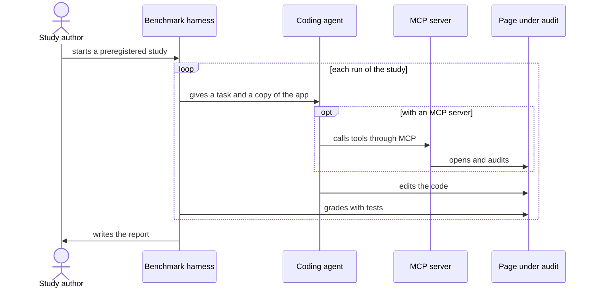
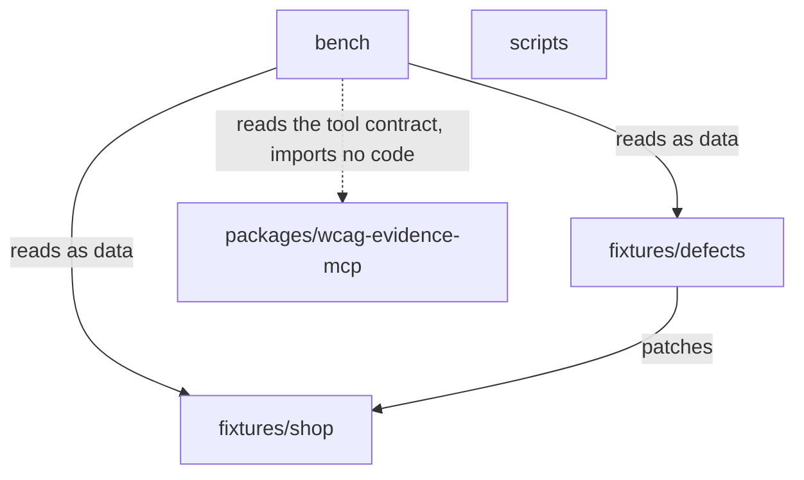

# Architecture

The repository has six parts, and the dependencies between them run one way. `npm run check:deps` checks the main boundaries as part of the local gate (`npm run ci`). This page shows who takes part in a study, what each part may depend on, how the server is split inside and how that is checked.

The reasons are in five ADRs (architecture decision records):

- [ADR 0001](adr/0001-scope-and-non-goals.md): what the project measures and what it leaves out.
- [ADR 0002](adr/0002-methodology.md): how a study is run and graded.
- [ADR 0003](adr/0003-monorepo-layout.md): the layout and the boundaries between the parts.
- [ADR 0004](adr/0004-server-architecture.md): the server's SDK, the parts inside it and what its tools return.
- [ADR 0005](adr/0005-url-policy.md): which URLs the server may open.

## A study



- The **study author** fixes the plan of a study before its first run (a preregistration) and publishes the report whatever the result is.
- The **benchmark harness** gives the agent a task: a copy of the reference Angular app with one seeded defect (a bug added on purpose). It then grades the result from outside the agent's folder and records the cost.
- The **coding agent** edits the app to fix the defect. The conditions of a study (the setups it compares) differ only in which MCP server the agent has; in the first study, one condition has none.
- The **MCP server** gives the agent tools that audit a page. The agent's MCP client starts the built server and talks to it only through the protocol, as it would for any user.
- The **page under audit** is a page of the app, served on the same machine. The server audits only local pages.

## The parts

Only `scripts`, `docs` and the server exist today: the server answers MCP requests and has one tool, `audit_route`. The [roadmap](../README.md#roadmap) says when each of the others arrives.

| Path                         | Part                                                                           | Depends on                                               | Exists today |
| ---------------------------- | ------------------------------------------------------------------------------ | -------------------------------------------------------- | ------------ |
| `packages/wcag-evidence-mcp` | The MCP server, which is published on its own                                  | Nothing else in the repository                           | One tool     |
| `fixtures/shop`              | The reference Angular app and its unit tests                                   | Nothing else in the repository                           | No           |
| `fixtures/defects`           | One folder per seeded defect: a patch, its metadata and its test               | `fixtures/shop`, as the target of the patches            | No           |
| `bench`                      | The harness (runner, grader, statistics, report), preregistrations and results | The two fixtures and the server's tool contract, as data | No           |
| `scripts`                    | Repository checks                                                              | Nothing else in the repository                           | Yes          |
| `docs`                       | ADRs and guides                                                                | Nothing (no code)                                        | Yes          |

The tool contract is the generated list of the server's tools and their schemas. The harness reads it as a file and never imports the server's code.

Each arrow is a dependency from the table above. A part with no arrow leaving it depends on no other part. `docs` holds no code and is not drawn.



## Inside the server

The server is split into ports and adapters ([ADR 0004](adr/0004-server-architecture.md)). Its source, in `packages/wcag-evidence-mcp/src/`, has three parts:

- `core/` holds the server's own logic: today the server's identity, the shape of its log, the catalog of the twelve WCAG criteria, the map of the axe-core rules tagged with them, the check of the URLs that the server may open ([ADR 0005](adr/0005-url-policy.md)), the ports of the browser and the rule engine, and the `audit_route` use case with its output. It imports nothing but itself and `zod`.
- `adapters/` holds the adapters. Each folder in `adapters/` connects the core to one outside thing. Today there are five: `mcp` (the MCP SDK over stdio), `log-stream` (stderr), `package-json` (the package's own `package.json`), `playwright` (Chromium, the browser) and `axe` (axe-core, run inside the page). An adapter may import anything the server may, except another adapter and `bin.ts`.
- `bin.ts` creates the adapters and wires them together. Apart from the adapters themselves and the tests, it is the only file of the server that imports an adapter, and nothing imports it.

The core cannot import axe-core ([ADR 0004](adr/0004-server-architecture.md)), so the map is a generated file that the core reads. `npm run gen` writes it, `core/axe-rules.json`, from the installed axe-core with the generator in `packages/wcag-evidence-mcp/scripts/`. A test fails when the map no longer matches axe-core.

### The browser

The browser port is `core/browser.ts`. The adapter in `adapters/playwright` drives Chrome Headless Shell, the build of Chromium for running without a window, through `playwright-core`. npm does not install the browser; this command downloads the build that the installed `playwright-core` expects:

```bash
npm run browser:install    # on Linux, add -- --with-deps for the system libraries it needs (it asks for administrator rights)
```

- **Lifecycle.** `bin.ts` creates the adapter once and passes it to the SDK's factory ([ADR 0004](adr/0004-server-architecture.md)). Chromium starts on the first visit, so a server that opens no page never starts it. After a crash, it starts again on the next visit. It closes when the MCP connection closes, because its processes would otherwise keep the server's process alive.
- **One context per visit.** Each visit opens its page in a browser context of its own, so no cookie or storage passes from one visit to another.
- **Time limits.** Chromium has 30 seconds to start, and the page 30 seconds to fire `load`, Playwright's default for a navigation. A whole visit, the caller's work on the page included, has 2 minutes. Then the visit fails with `timeout`, and its context is closed, which ends whatever still waits on the page. A browser that stops answering without closing gets 1 second more to answer or to close the context, so a visit never takes longer than its limit and that second.
- **Waiting for the page to settle.** An Angular app starts after `load`, and often fills a route with data that it asks for later, so an audit at `load` would read a half-drawn page and miss findings. After `load`, the visit waits until, for 500 milliseconds, the DOM has not changed and no request of the page has been in flight: the quiet time that Playwright's `networkidle` wait uses. It waits 10 seconds at most, and never more than half of what is left of the visit, so the rules always have time to run. A page still changing at the end of the wait is audited as it is, and the output says so: `page.settled` is false. Settled means only that the page went 500 milliseconds with no change to its DOM and no request in flight. It does not mean that the page is complete: content that a timer adds later, such as an Angular `@defer (on timer(2s))` block, is missed, and the page still reads as settled. A request that stays open, such as a stream of server events or a long poll, keeps the page from settling, so every audit of it waits the 10 seconds; a WebSocket does not. The wait runs in the isolated world described below, so a page cannot fake a settled state, but a page that changes its DOM all the time never settles.
- **Result.** A visit returns what the caller made of the page; while it works, the caller can read from the page the requests that the policy refused. Or the visit fails with one of six stable reasons: `url-policy`, `not-local`, `navigated`, `load-failed`, `timeout` or `browser-unavailable`. `navigated` means that the page went to another document after the one asked for had loaded, as through a redirect in a script: the new document passed neither layer 3 nor the status check, so it is not audited and not followed. A change of URL within the same document, as an Angular router makes, does not count. A browser that closes or crashes during a visit gives `browser-unavailable`, not an error.

The adapter builds layers 2 and 3 of the URL policy ([ADR 0005](adr/0005-url-policy.md)). Three things that ADR 0005 left to the browser port are decided here: `data:`, `blob:` and `about:` URLs, the WebSocket of a development server, and whether layer 3 counts `::1`. One channel that the ADR does not name, WebRTC, is closed too. The adapter checks each request with `checkUrl`, in the form that Chromium writes the URL:

- **A request** of the page, of its frames or of its dedicated workers (a subresource, a frame, a `fetch`) is aborted before it leaves the browser when `checkUrl` refuses it. Playwright's interception does this. It does not see the requests of a shared worker or of speculation rules: see [Limits against ADR 0005](#limits-against-adr-0005).
- **A redirect hop** cannot be stopped, because Playwright's interception does not see it. Chromium's resolver rule lets only `localhost` and `127.0.0.1` resolve, so a hop to another host fails. A local hop that fails `checkUrl` is seen but not stopped: see [Limits against ADR 0005](#limits-against-adr-0005).
- **A WebSocket** of the page or its frames is checked as the `http` URL with the same host, port and path, so the `ws://localhost:4200/` of a development server connects and its live reload keeps working. A refused one is closed with code 1008. The WebSockets of workers are not seen: see [Limits against ADR 0005](#limits-against-adr-0005).
- **A service worker** is blocked.
- **`data:`, `blob:`, `about:blank` and `about:srcdoc`** are allowed, because an Angular page can use them and none of them makes a network request. The requests of what they load are checked like any other.
- **WebRTC** sends no UDP packet. Chromium runs with `--force-webrtc-ip-handling-policy=disable_non_proxied_udp`, which allows UDP only through a proxy, and there is none. Without it, a page sent STUN packets (the first messages of a WebRTC connection) to an address that it wrote itself, and neither the interception, the resolver rule nor layer 3 saw them.
- **The page's document,** once loaded, must come from `127.0.0.1` or `::1`: that is layer 3. `::1` counts because Chromium connects `localhost` to it whenever a server listens there: first when the server listens on both addresses, and only there when it listens on `::1` alone, as a development server can.

Chromium runs without a proxy. With the system's proxy, the proxy would resolve names for it: a proxy on the local machine passes the resolver rule and would fetch any host for the browser.

The same `checkUrl` reads the URLs that an agent writes and those that Chromium writes. Among the URLs tested, Chromium writes only two in a form that `checkUrl` refuses: one with a `\` in its query, and one with port 80, which it writes without a port. ADR 0005 refuses both.

The facts in this section were observed on Windows on 2026-11-21, with the Chrome Headless Shell that `playwright-core` 1.65.1 installs (159.0.8154.6).

The tests in `packages/wcag-evidence-mcp/test/playwright-*.test.ts` run each layer against a site on `127.0.0.1` and a second one on `127.0.0.2`, which stands for another host. Each test that guards one layer uses a request that only that layer stops.

### Limits against ADR 0005

ADR 0005 says that layer 2 cuts the requests to other hosts and intercepts WebSockets. Four kinds of traffic get past Playwright's interception. Chromium's resolver rule still keeps each of them on `localhost` or `127.0.0.1`, so none leaves the machine. But each can reach any local port, in a form that `checkUrl` refuses, and the visit does not list it unless this says so:

- **A redirect hop.** The interception does not see it, so a local hop that fails `checkUrl`, such as one to port 80, reaches its service. The visit then fails if the hop belongs to the page's document, and lists the hop if it belongs to a subresource. Option C of ADR 0005, the interception of the DevTools Protocol, would see every hop; it was not chosen because Playwright does not wrap it.
- **The WebSockets of a dedicated worker.** Playwright's `routeWebSocket` sees those of the page and its frames only.
- **The requests and WebSockets of a shared worker.** Neither interception sees them. Blocking shared workers would break the apps that use them.
- **Speculation rules,** a `<script type="speculationrules">` that asks Chromium to prefetch or prerender a page. Their requests reach the site without passing the interception, and `--disable-blink-features=SpeculationRules` does not turn them off.

These were observed with the same build, on the same day.

### The rule engine

axe-core has to run inside the page, and the axe-core adapter may not import the browser's adapter (rule 2 of [ADR 0004](adr/0004-server-architecture.md)). So the core is the only meeting point:

1. The browser port gives the page as a core type, `LoadedPage`. Its way in for the rules is `evaluateIsolated(script)`, which runs a script in a world of its own and returns its JSON.
2. The rule engine port, `core/rule-engine.ts`, takes that `LoadedPage` and the rules to run. Its adapter in `adapters/axe` builds one script with the source of the installed axe-core and runs it through `evaluateIsolated`. It reads the rectangle and the document position of each failing element there, since an element cannot leave the page.
3. The use case in `core/audit.ts` asks the browser port for a visit and, inside it, the rule engine for a run. `bin.ts` creates both adapters and passes them in.

`auditRoute` is today the transport port of ADR 0004: the functions of the core that the MCP adapter calls. ADR 0004 named `describeServer`, the function of the provisional `server_info` tool, which `audit_route` replaced.

**The isolated world.** The Playwright adapter opens it through the DevTools Protocol (`Page.createIsolatedWorld`), as a browser extension runs its scripts. It shares the page's DOM, which is all that axe-core and the wait need, but none of the page's JavaScript. A page that defines its own `window.axe`, or changes `Array.prototype.map` or `MutationObserver`, changes only its own world, and the audit is the same; a test checks each of the three. The page can still change its DOM while the rules run.

The adapter checks the fields of the script's result that it uses, and accepts only the check ids that the installed axe-core defines. The core then checks every finding again with strict schemas. Anything unexpected makes the tool answer with an error, never with an empty audit.

### The tool `audit_route`

`audit_route` takes the URL of a page and, optionally, a list of criteria. The URL goes through the three layers of the URL policy. The output follows the contract of [ADR 0004](adr/0004-server-architecture.md):

- **Rules.** The rules that axe-core runs by default for the twelve criteria, plus `target-size` for 2.5.8: 48 rules with axe-core 4.14.0, read from the rule map, not from a list in the code. Experimental and deprecated rules stay out. What axe-core marks for review is not returned.
- **Findings.** One per element that fails a rule: an identifier, the criteria of the twelve that the rule checks, the rule, the measurement and the location (the selector and the rectangle). The measurement holds what axe-core measured: the contrast ratio, the colors and the font size; the size of a target and its distance to the next one; or, for any other rule, the ids of the checks that failed. The location will also hold the Angular component.
- **Little page text.** The selector is the one piece of text that the page's code writes into the output: no accessible name, no HTML and no message of axe-core, so that the page has little room to write instructions there. The check ids come from the installed axe-core. The messages of an error are the server's own, and repeat only the URL that the agent gave.
- **Definitions.** The name and requirement of each criterion that the findings name, once, from the catalog, and a link to its Understanding page at the W3C, while the server has no resources of its own.
- **Order and identifiers.** By criterion, then rule, then document order. The identifier is FNV-1a (a short non-cryptographic hash) of the route, the rule and the selector without Angular's style attributes and the number that ends an `id` such as `cdk-overlay-0`. The route is the path of the URL, without the query, and with the fragment when it starts with `#/`, as in an app that routes by fragment. When two hashes collide, the element's position in the document is added. A filter by criterion gives the same identifiers.
- **Cap.** The serialized output stays under 20,000 characters, everything included. When it does not fit, the output keeps the first findings, says that it is truncated and counts, per rule, the findings left out, with the rule's criteria. A filter by those criteria shows more of them, but not those beyond the cap for a single criterion: there is no pagination. On a test page with 120 images without a text alternative, a finding took 278 characters, and the cap kept 69 of them in 19,723 characters (measured on 2026-11-21). At three to four characters per token, the ratio of ADR 0004, that is about 5,000 to 6,600 tokens, under Claude Code's warning of 10,000.
- **Annotations.** The tool is read-only and idempotent: it changes nothing itself. The page's own scripts do run, though, and can send requests to the local app. Its `openWorldHint` is false: the URL policy keeps it on pages served by this machine.

The output goes beyond the contract of ADR 0004 in six ways, accepted with the change that added the tool:

- **`page`:** the HTTP status of the document, how many requests of the page the URL policy refused (a count, with no URL) and whether the page settled. So a 404 page, a page that lost a stylesheet to the policy or a page audited while it still changed does not read as a normal audit.
- **`notChecked`:** the criteria asked for that no rule checks yet, today 2.1.2, 2.4.3, 2.4.7 and 2.4.11, whose own checks come later, so that a clean page does not read as a pass. 2.1.1 is checked only through its three axe-core rules until its own check arrives.
- **`failed-checks`:** the measurement of a rule that has no numbers to report.
- **The wait:** the page is audited once it has settled, or at the end of the wait, and the output says so: `page.settled` is false.
- **The filter:** it keeps the findings of the rules that carry any of the criteria asked for, and each finding still lists all its criteria of the twelve. Each entry of `leftOut` names the criteria of its rule, so that the agent knows what to ask for.
- **No frames:** the tool audits the page's top document only. A defect inside an `iframe` is not found. axe-core is not asked to look into frames either: a frame that loads its own axe-core would answer with elements that are not in the top document, and the audit would fail. axe-core would have to be loaded into each frame, each in a world of its own, and its findings placed back on the top page; an Angular app draws its views in the top document, so a frame holds content of another app, such as an embedded map.

## How the boundaries are checked

```bash
npm run check:deps
```

The command runs [dependency-cruiser](https://github.com/sverweij/dependency-cruiser), which reads the imports written in the code (`import`, `export … from`, `import type`, `require()` and `import()` with a fixed string) and checks them against the rules in `.dependency-cruiser.js`. It does not see a module name built at run time, a `require` function under another name, a worker or a process started from a path (such as the server that an MCP configuration starts, so the check cannot tell whether it is the built one), a file read with `fs`, or a path in a configuration file: an Angular template, `angular.json` or the `extends` of a `tsconfig.json`. When an import breaks a rule, the command fails and prints the name of the rule and the files involved.

| Rule                                        | What it forbids                                                                                                                                                                      |
| ------------------------------------------- | ------------------------------------------------------------------------------------------------------------------------------------------------------------------------------------ |
| `server-imports-nothing-outside-its-folder` | The server importing anything outside its own folder, except installed packages and Node built-ins                                                                                   |
| `app-imports-nothing-outside-its-folder`    | `fixtures/shop` importing anything outside its own folder, except installed packages and Node built-ins                                                                              |
| `bench-reaches-no-server-code`              | `bench` reaching a file in the server's folder, directly or through a chain of imports                                                                                               |
| `scripts-import-no-other-part`              | `scripts` importing anything from `packages`, `fixtures` or `bench`                                                                                                                  |
| `no-circular-imports`                       | A chain of imports that comes back to the file where it started, anywhere in the repository                                                                                          |
| `server-imports-no-dev-dependency`          | The server's published code importing a package that the server's own `package.json` lists only under `devDependencies`, or does not list (even if the root `package.json` lists it) |
| `server-imports-no-test-or-config`          | The server's published code importing one of the server's tests or tool configuration files                                                                                          |
| `no-unresolvable-imports`                   | An import that the tool cannot resolve to a file, an installed package or a Node built-in, anywhere in the repository                                                                |
| `server-core-imports-only-core-and-zod`     | The server's core importing a Node built-in, a package other than `zod` or a file of the server outside the core                                                                     |
| `server-adapter-imports-no-other-adapter`   | One adapter of the server importing another                                                                                                                                          |
| `server-wires-adapters-only-in-bin`         | A file of the server importing an adapter, unless it is in an adapter's folder, is `src/bin.ts`, or is not published (a test or a configuration file at the server's root)           |
| `nothing-imports-server-bin`                | Any file importing the server's binary, `src/bin.ts`, or its build, `dist/bin.js`                                                                                                    |

The first eight rules come from ADR 0003 and the last four from ADR 0004. Details of how the rules read the code:

- An `import type` counts as an import in every rule, and so does a type that a JavaScript file takes in a JSDoc comment. A Node built-in loaded with `process.getBuiltinModule` counts as an import of it.
- The rules for the core and the adapters skip the server's code that is not published: the tests (files named `*.test.*`, and the server's top-level `test` folder) and the configuration files at its root. So a test may import any adapter. No file may import the binary, tests included.
- An installed package counts only when it is imported by its name. A relative path into a `node_modules` folder is reported, also when that folder is inside the part.
- An import of the server by its package name, `wcag-evidence-mcp`, counts as an import of the server. The server's package has no `exports` or `main` field, so the tool cannot resolve that import, and `no-unresolvable-imports` reports it too.
- On a clean checkout, `npm run check:deps` runs before anything is built, so code cannot import a file that a build step generates unless the file is committed; the server's own tests import its code by path, not by its package name.
- This configuration does not make the tool read the `paths` of a `tsconfig.json`. An import through such an alias cannot be resolved and fails the check: write the relative path.
- The server's published code is every source file in its folder except three kinds: the tests (JavaScript or TypeScript files named `*.test.*`), the `test` folder at the root of the server and the tool configuration at its root (JavaScript or TypeScript files named `*.config.*`). A `test` folder or a `*.config.*` file deeper in the folder, such as `src/audit.config.ts`, is published code. So is the server's `scripts/` folder, although the package does not ship it: the rules stay stricter there, and it may not import a development dependency or an adapter.
- Installed packages and generated folders, such as `dist` and `coverage`, are not read. An import that leads to one of their files counts; the imports inside them do not.

The rules check the boundaries that ADRs 0003 and 0004 list, not every line of the parts table. For example, no rule keeps `fixtures/defects` or `bench` from importing `scripts`. No rule forbids an import from `fixtures/defects` into the server either, but `bench-reaches-no-server-code` reports it as soon as a file of `bench` reaches it. Inside the server, a file that is neither the core, an adapter nor `bin.ts` is checked only for importing an adapter or the binary, besides the rules of ADR 0003.

A rule for a part that does not exist yet checks nothing until the part's first file arrives. The tests in `scripts/module-boundaries.test.ts` and `scripts/module-boundaries.reading.test.ts` show that each rule works anyway: they build a small copy of the planned layout in a temporary folder, add forbidden imports and expect each rule to report them.

## The import graph of the code

```bash
npm run --silent deps:graph
```

The command prints the imports between the files of `packages`, `fixtures`, `bench` and `scripts` as a Mermaid diagram (a text format for diagrams that GitHub renders). `--silent` keeps npm's own lines out of the output. To see the diagram, paste the output into a `mermaid` code block in any Markdown file or comment on GitHub. Today it shows only `scripts` and the server.
